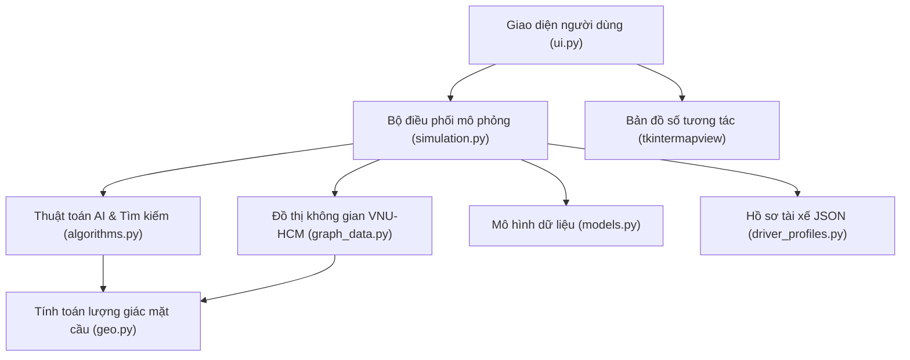

# BÁO CÁO TỔNG QUAN VÀ PHÂN TÍCH CHUYÊN SÂU DỰ ÁN
# QKM SMARTRIDE: HỆ THỐNG ĐẶT XE CÔNG NGHỆ THÔNG MINH

---

## 1. Giới thiệu ứng dụng 

- **Xây dựng phần mềm mô phỏng hoàn chỉnh (Desktop GUI Application):** Cung cấp giao diện trực quan sinh động trên nền bản đồ số vệ tinh/vectơ OpenStreetMap, cho phép người dùng theo dõi toàn bộ vòng đời của một cuốc xe từ lúc phát sinh nhu cầu đến khi hoàn tất chuyến đi.
- **Áp dụng và kiểm chứng các thuật toán AI:**
  - *Thuật toán tìm kiếm tài xế:* **Local Search** (thuật toán trọng tâm), **BFS**, **DFS**, **Greedy Search**, **UCS**.
  - *Thuật toán định tuyến đường đi:* **A\*** (thuật toán trọng tâm), **UCS (Dijkstra)**, **BFS**, **DFS**, **Greedy Best-First Search**.
- **Xây dựng công cụ phân tích và đối sánh hiệu năng (Benchmarking Suite):** Đo lường định lượng các chỉ số: thời gian xử lý ($\text{ms}$), số lượng node mở rộng/duyệt ($\text{Visited Nodes}$), chi phí đường đi ($\text{Cost/Distance}$), tỷ lệ tối ưu nghiệm.
- **Tích hợp bộ biên tập đồ thị giao thông tương tác (Interactive Graph Editor):** Cho phép người dùng can thiệp trực tiếp vào cấu trúc đường, cắm biển cấm đường, thiết lập độ khó đi (đường xấu x1.5, đường rất xấu x2.0) để quan sát khả năng tái định tuyến (dynamic rerouting) thông minh của các thuật toán.

---

## 2. Công nghệ & Thư viện sử dụng (Tech Stack & Libraries)

Dự án được xây dựng với cấu trúc mã nguồn Python hiện đại, tuân thủ nguyên lý thiết kế mô-đun (Modular Architecture) và phân tách rõ ràng giữa tầng dữ liệu (Data Layer), logic thuật toán (Algorithm Core), mô phỏng (Simulation Engine) và giao diện hiển thị (User Interface Layer):

### Chi tiết các công nghệ chính:

| Phân hệ / Thư viện | Phiên bản / Chi tiết | Vai trò và Ứng dụng trong dự án |
| :--- | :--- | :--- |
| **Ngôn ngữ lập trình Core** | `Python 3.10+ / 3.13` | Ngôn ngữ phát triển toàn bộ dự án; sử dụng cấu trúc `typing`, `dataclass` và chuẩn hóa OOP giúp mã nguồn sáng sủa, dễ bảo trì và mở rộng. |
| **Tkinter & Ttk** | Thư viện chuẩn Python | Xây dựng bộ khung giao diện Desktop (GUI), quản lý luồng sự kiện (Event Loop), timer cập nhật chuyển động xe (`after()`), các thanh trượt (`Slider`), bảng điều khiển đa phân vùng. |
| **Custom Canvas UI Components** | `RoundedFrame`, `RoundedButton`, `NavItemButton` | Nhóm tự tay cài đặt các thành phần giao diện bo góc hiện đại trên `tk.Canvas`, xử lý hiệu ứng hover, active, chuyển trạng thái và hỗ trợ responsive mượt mà thay vì dùng widget Tkinter thô sơ mặc định. |
| **tkintermapview** | `v1.29` | Hiển thị bản đồ số OpenStreetMap (OSM) tương tác trực tiếp (Pan, Zoom, kéo thả), định vị tọa độ GPS, vẽ Polyline tuyến đường nhiều màu sắc, quản lý các Marker xe và khách. |
| **Pillow (PIL)** | `>=10.0.0` | Xử lý hình ảnh đồ họa tài nguyên: tải, xoay, resize icon xe máy (`driver_motorbike.png`), khách hàng (`customer.png`), xe đang chở khách (`ride_motobike.png`), biển cấm đường (`BienCam.png`). |
| **Hệ thống dữ liệu Đồ thị** | `CampusGraph` (`graph_data.py`) | Mô hình hóa bản đồ Làng Đại học gồm hơn **100+ node tọa độ thực** và hàng trăm cạnh đường hai chiều. Quản lý trạng thái đường (`ROAD_NORMAL`, `ROAD_BAD`, `ROAD_VERY_BAD`, `ROAD_BLOCKED`). |
| **Công thức địa lý mặt cầu** | `Haversine formula` (`geo.py`) | Tính toán khoảng cách trắc địa đường cong mặt cầu Trái Đất ($R \approx 6371\text{ km}$) dựa trên vĩ độ/kinh độ chính xác, dùng làm hàm đánh giá khoảng cách và Heuristic cho thuật toán $A^*$. |
| **Thuật toán Nội suy Tọa độ** | `Linear Interpolation` (`geo.py`) | Chia nhỏ từng cạnh đường thành $k=5$ điểm phụ trợ, giúp animation chuyển động của marker xe di chuyển trơn tru trên bản đồ. |
| **Quản lý dữ liệu JSON** | `data/driver_profiles.json` | Lưu trữ hồ sơ định danh tài xế: Họ tên, số điện thoại, biển số, loại phương tiện, sao đánh giá (Rating), tỷ lệ nhận chuyến, nhãn tài xế 5 sao. |

---

## 3. Các tính năng chính của hệ thống (Key Features)

### QKM SmartRide sở hữu hệ sinh thái tính năng hoàn chỉnh, mô phỏng chân thực quy trình vận hành của một ứng dụng gọi xe:

#### Khởi tạo và Quản lý Thực thể Linh hoạt

#### Hệ sinh thái Tìm kiếm & Ghép nối Tài xế (Driver Dispatching)

#### Định tuyến Hai chặng Độc lập (Two-phase Multi-route Pathfinding)

- **Chặng 1 (Pickup Route):** Dẫn đường cho tài xế từ vị trí hiện tại đến Điểm đón khách (hiển thị bằng **Polyline màu xanh dương**).
- **Chặng 2 (Dropoff Route):** Dẫn đường chở khách từ Điểm đón đến Điểm đến cuối cùng (hiển thị bằng **Polyline màu đen**).
- Hỗ trợ đổi thuật toán linh hoạt qua combobox: $A^*$, UCS, BFS, DFS, Greedy Search.

#### Động cơ Mô phỏng Chuyển động Thời gian thực (Real-time Live Animation Engine)

#### Bộ công cụ Chỉnh sửa Đồ thị Giao thông (Interactive Graph Editor)
- Cho phép bật/tắt hiển thị toàn bộ mạng lưới giao thông (các đường nối màu xanh lơ) và các Node giao lộ.
- Thêm node mới bằng cách click lên bản đồ, cơ chế bắt dính thông minh (Snap Distance) vào các node có sẵn.
- **Thiết lập trạng thái đoạn đường tương tác:**
  - *Đường bình thường:* Hệ số chi phí $\times 1.0$.
  - *Đường xấu:* Hệ số chi phí $\times 1.5$.
  - *Đường rất xấu:* Hệ số chi phí $\times 2.0$.
  - *Đường cấm (Blocked):* Trọng số bằng vô cực ($\infty$), hiển thị biển cấm `BienCam.png`.
- Tự động lưu cấu trúc đồ thị mới trực tiếp vào file mã nguồn Python `graph_data.py`.

#### Bảng Phân tích & Đối sánh Thuật toán Độc lập (Algorithm Benchmarking Suite)
- **Tab Đối sánh Tìm tài xế:** So sánh BFS, DFS, Local Search, UCS, Greedy Search theo số tài xế tìm được, số node đã duyệt, thời gian thực thi theo từng bán kính.
- **Tab Đối sánh Tìm đường đi:** So sánh $A^*$, BFS, DFS, UCS, Greedy Search theo tổng chi phí thực tế ($\text{km}$), số lượng node mở rộng ($\text{Visited Nodes}$) và thời gian tính toán ($\text{ms}$).

#### Quản lý Lịch sử Chuyến đi & Thẻ Hồ sơ Tài xế (Driver Profile Modal)

---

## 4. Các yếu tố nổi bật:

### 🌟 4.1. Kỹ thuật "Snap-to-road" và Cơ chế Tạo Dynamic Node trên Bản đồ Thực tế

1. Nhóm đã xây dựng hàm toán học chiếu hình học `add_connected_point_near_road()` và `random_point_on_road()`:
  - Khi người dùng click chọn một vị trí ngẫu nhiên trên bản đồ (hoặc sinh ngẫu nhiên), hệ thống tính toán khoảng cách vuông góc từ tọa độ đó tới tất cả các đoạn thẳng (cạnh đường) lân cận.
  - Nếu khoảng cách nằm trong ngưỡng cho phép ($\le 80\text{ m}$), hệ thống tự động **chẻ đôi cạnh đường hiện tại (Split Edge)** và chèn một **Dynamic Node (Node động)** tạm thời mang tiền tố `DRIVER_...`, `PICKUP_...`, `DEST_...`.
  - Cập nhật tức thời danh sách kề (`CampusGraph.adj`) để các thuật toán $A^*$, UCS có thể định tuyến trực tiếp từ chính xác vị trí đó.
  - Khi chuyến đi kết thúc, các node động được dọn dẹp sạch sẽ để tránh làm phình đồ thị gốc.

### 🌟 4.2. Hệ thống Trọng số Đường động Thích ứng (Dynamic Road Conditions & Blocked Edges)

### 🌟 4.3. Cơ chế Lựa chọn Ngẫu nhiên có Trọng số trong Top-3 Ứng viên (Probabilistic Top-3 Selection)

### 🌟 4.4. Tích hợp Trực tiếp Bộ Biên tập Đồ thị "No-code/Low-code" (In-App Graph Editor)
- Thay vì phải xuất tọa độ ra các phần mềm bên ngoài như QGIS hay chỉnh sửa thủ công bằng tay từng dòng code dữ liệu tọa độ cực kỳ mất thời gian và dễ sai sót, nhóm đã tự xây dựng một **Graph Editor hoàn chỉnh ngay trên giao diện Tkinter**:
  - Click chuột để thêm node, tự động tính tọa độ GPS.
  - Cho phép Undo, Clear, cấu hình bán kính bắt node cũ.
  - Đặc biệt: Cung cấp tính năng **"Lưu dữ liệu bản đồ vào file mã nguồn"**, tự động phân tích cây cú pháp và ghi đè cập nhật dictionary `GRAPH_NODES` và danh sách kề trong file `graph_data.py`. Đây là tính năng nâng cao thể hiện tư duy công cụ hóa (Tooling mindset) vượt bậc của nhóm.

### 🌟 4.5. Kiến trúc Giao diện Hiện đại (Modern Custom Tkinter Canvas Architecture)
- Tkinter vốn nổi tiếng là cổ điển và thô cứng. Nhóm đã tự thiết kế lại hoàn toàn hệ thống UI:
  - Tự vẽ các widget bo tròn (`RoundedButton`, `RoundedFrame`) bằng vector math trên `tk.Canvas`.
  - Thiết kế **Splitter Bar** cho phép người dùng kéo thả thay đổi kích thước linh hoạt giữa khung Bản đồ và khung Dashboard.
  - Thanh Navigation Rail thông minh: Tự động mở rộng khi rê chuột (`<Enter>`) và thu gọn khi rời chuột (`<Leave>`), tiết kiệm tối đa diện tích hiển thị bản đồ.

---

## 5. Kỹ năng học được thông qua dự án:

### 5.1. Giá trị học thuật đối với Chuyên ngành Trí tuệ Nhân tạo

1. **Hiểu sâu bản chất Không gian trạng thái (State Space) và Đồ thị tri thức không gian (Spatial Graph):**
   - Không còn dừng lại ở các bài toán đồ chơi (Toy Problems) như mê cung ma trận lưới 2D hay bài toán 8-puzzle, sinh viên được trực tiếp mô hình hóa một mạng lưới giao thông thực tế thành đồ thị có trọng số với hàng trăm nút tọa độ GPS thực tế.
2. **Kỹ năng thiết kế hàm Heuristic Admissible và Consistent:**
   - Khi áp dụng thuật toán $A^*$, sinh viên chứng minh được rằng hàm khoảng cách trắc địa Haversine ($h(n)$) trên mặt cầu luôn là một **Admissible Heuristic** (vì khoảng cách đường chim bay luôn nhỏ hơn hoặc bằng khoảng cách di chuyển thực tế trên mạng đường: $h(n) \le h^*(n)$).
   - Nhờ đó, thuật toán $A^*$ luôn đảm bảo tính tối ưu toàn cục ($\text{Optimality}$) nhưng giảm thiểu đáng kể số nút phải duyệt so với Uniform Cost Search (Dijkstra).
3. **Phân tích so sánh đa thuật toán (Algorithm Profiling & Benchmarking):**
   - Sinh viên trực tiếp xây dựng môi trường thử nghiệm đối chứng (A/B Testing cho thuật toán), đánh giá định lượng:
     - *Local Search vs Graph Traversal (BFS/DFS/UCS):* Thấy rõ ưu thế của Local Search khi lọc nhanh theo không gian Euclidean/Haversine mà không cần duyệt toàn bộ cây đồ thị.
     - *$A^*$ vs UCS vs Greedy Best-First:* Chứng minh thực nghiệm việc $A^*$ cân bằng hoàn hảo giữa hàm chi phí thực tế $g(n)$ và hàm ước lượng $h(n)$, tránh việc duyệt mù quáng như UCS và tránh rơi vào bẫy cục bộ không tối ưu như Greedy Search.
4. **Mô hình hóa hệ thống Đa tác tử (Agent-based Modeling):**
   - Xây dựng mô hình tương tác giữa các Tác tử Tài xế ($\text{Driver Agents}$) và Tác tử Khách hàng ($\text{Customer Agents}$) dưới sự điều phối của hệ thống trung tâm ($\text{Dispatcher System}$).

### 5.2. Các kỹ năng Kỹ thuật phần mềm (Software Engineering) đạt được
- **Tư duy Kiến trúc sạch (Clean Architecture & Modular Programming):** Phân tách độc lập các module: `models` (dữ liệu), `geo` (toán học), `graph_data` (đồ thị), `algorithms` (thuật toán AI), `simulation` (luồng nghiệp vụ) và `ui` (hiển thị).
- **Lập trình Hướng đối tượng nâng cao (OOP):** Tận dụng tối đa `dataclass`, đóng gói trạng thái, quản lý vòng đời chuyến đi thông qua các lớp thực thể `Driver`, `Customer`, `ActiveRide`, `RideHistory`.
- **Tối ưu hóa thuật toán & Cấu trúc dữ liệu:** Sử dụng `heapq` (Min-heap / Priority Queue) cho $A^*$ và UCS để đạt độ phức tạp $O(E \log V)$, sử dụng `collections.deque` cho BFS để đạt $O(1)$ cho thao tác pop/append, gom nhóm tài xế theo node để truy vấn tức thời $O(1)$.
- **Kỹ năng trực quan hóa dữ liệu (Data & Algorithm Visualization):** Khả năng chuyển đổi các cấu trúc dữ liệu trừu tượng thành giao diện đồ họa sống động, giúp người xem dễ dàng hiểu được luồng đi của thuật toán.

---